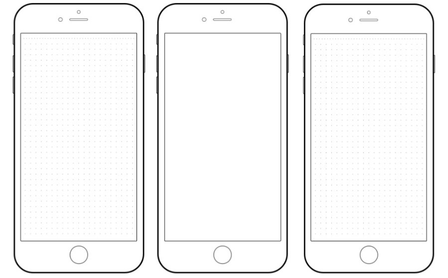
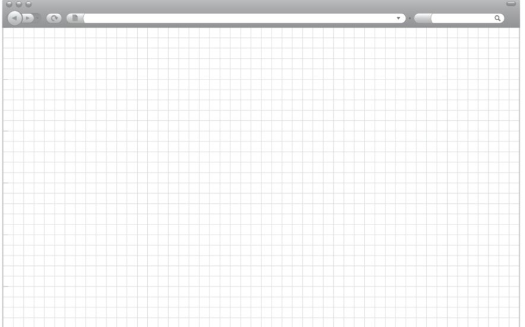

# Templates oficiales de la cátedra

Referencias de la consigna de **Taller de Desarrollo Web, Universidad Católica de Córdoba**. Consultadas el **26 de octubre de 2026** desde la [consigna oficial](https://ucc-tallerdesarrolloweb.github.io/filminas/Proyecto.html#/7), que enlaza estos templates en las diapositivas de Sketch.

| Archivo original conservado | Fuente pública | Dimensiones |
|---|---|---|
| [GTP_sketchMovil.jpg](GTP_sketchMovil.jpg) | [Template móvil UCC](https://ucc-tallerdesarrolloweb.github.io/filminas/images/proyecto/GTP_sketchMovil.jpg) | 899 × 557 px |
| [GTP_sketchDesktop.jpg](GTP_sketchDesktop.jpg) | [Template escritorio UCC](https://ucc-tallerdesarrolloweb.github.io/filminas/images/proyecto/GTP_sketchDesktop.jpg) | 884 × 552 px |

Los JPG se conservan sin modificaciones. Se usan como fondo en las [láminas de sketch](../con-plantilla/README.md); el contenido de Laure Joyas se inserta como texto y formas vectoriales editables dentro de las zonas de pantalla. La composición y las exportaciones son **digitales**, no dibujos realizados en papel. La autoría del template corresponde a la referencia educativa indicada; no se presenta como un diseño original del equipo.

