# Wireframe / mockup digital — Laure Joyas

Mockups vectoriales con paleta oscura y dorada, tipografía Montserrat, jerarquía y contenido específicos de Laure Joyas. Se diseñaron siete pantallas completas en escritorio (1440 px de ancho) y móvil (390 px), además de sus estados de validación. Cada diseño tiene **SVG editable** y **PNG visible en GitHub**.

Son prototipos de interfaz, no capturas de la implementación. Las ilustraciones vectoriales del mockup representan el lugar de las fotografías de producto. El diseño móvil adapta los bloques a una columna; la navegación se distribuye en dos filas visibles.

**Template oficial:** se encontró la referencia de la cátedra en la [consigna UCC](https://ucc-tallerdesarrolloweb.github.io/filminas/Proyecto.html#/7) y se aplicó digitalmente a los sketches. Consultá las [láminas con template](../Sketch/con-plantilla/README.md) y las [referencias originales](../Sketch/plantillas/README.md).

**Alcance académico:** estos bocetos son digitales; no son dibujos hechos a mano ni en papel. El template oficial está aplicado en las láminas enlazadas, pero eso no acredita por sí solo el requisito de prototipo en papel. Esa evidencia debe incorporarse aparte si la cátedra la exige.

## Cobertura y fuentes editables

| Pantalla | Contenido diseñado | Escritorio | Móvil |
|---|---|---|---|
| Inicio | Hero, CTA de catálogo/cotizador, tres destacados y tarifas | [PNG](pantallas/inicio-desktop.png) · [SVG](pantallas/inicio-desktop.svg) | [PNG](pantallas/inicio-mobile.png) · [SVG](pantallas/inicio-mobile.svg) |
| Catálogo | Búsqueda, categoría, orden y las seis piezas con precio y acción | [PNG](pantallas/catalogo-desktop.png) · [SVG](pantallas/catalogo-desktop.svg) | [PNG](pantallas/catalogo-mobile.png) · [SVG](pantallas/catalogo-mobile.svg) |
| Cotizador | Metal, peso, gemas, grabado, cálculo desglosado y tarifas | [PNG](pantallas/cotizador-desktop.png) · [SVG](pantallas/cotizador-desktop.svg) | [PNG](pantallas/cotizador-mobile.png) · [SVG](pantallas/cotizador-mobile.svg) |
| Contacto | Dirección y correos académicos de los dos autores; sin formulario ficticio | [PNG](pantallas/contacto-desktop.png) · [SVG](pantallas/contacto-desktop.svg) | [PNG](pantallas/contacto-mobile.png) · [SVG](pantallas/contacto-mobile.svg) |
| Carrito | Dos piezas, cantidades, eliminar, cupón, descuento, total y acciones | [PNG](pantallas/carrito-desktop.png) · [SVG](pantallas/carrito-desktop.svg) | [PNG](pantallas/carrito-mobile.png) · [SVG](pantallas/carrito-mobile.svg) |
| Acceso | Correo, contraseña, iniciar sesión y enlace para crear cuenta | [PNG](pantallas/acceso-desktop.png) · [SVG](pantallas/acceso-desktop.svg) | [PNG](pantallas/acceso-mobile.png) · [SVG](pantallas/acceso-mobile.svg) |
| Crear cuenta | Nombre, correo, contraseña, confirmación y condiciones de demo | [PNG](pantallas/crear-cuenta-desktop.png) · [SVG](pantallas/crear-cuenta-desktop.svg) | [PNG](pantallas/crear-cuenta-mobile.png) · [SVG](pantallas/crear-cuenta-mobile.svg) |
| Estados y validación | Diez estados contextualizados de error, confirmación y éxito local | [PNG](pantallas/validaciones-desktop.png) · [SVG](pantallas/validaciones-desktop.svg) | [PNG](pantallas/validaciones-mobile.png) · [SVG](pantallas/validaciones-mobile.svg) |

## Reglas y estados representados

- **Cotizador:** peso entre 1 y 500 g; gemas enteras entre 0 y 30; grabado opcional de hasta 25 caracteres. Los errores usan alert, limpian el campo y devuelven el foco. Ejemplo calculado: oro 18k 10 g ($950.000) + 2 gemas ($50.000) + grabado ($5.000) = **$1.005.000 ARS**.
- **Carrito:** dos productos (1 unidad cada uno) suman $2.100.000; LAURE10 descuenta $210.000; total $1.890.000. Se incluyen cupón inválido, carrito vacío y confirmación antes de vaciar.
- **Cuenta:** nombre 2–60 (letras, espacios, guion o apóstrofo), correo válido de hasta 80 caracteres y contraseña 8–128 con confirmación. Se muestran credenciales inválidas, confirmación diferente, correo duplicado, cuenta creada e identificación de sesión activa. Mensajes de cuenta representativos del comportamiento de validación; no sustituyen una captura de cada mensaje de ejecución.
- **Contacto:** Obispo Trejo 323, Córdoba y enlaces de correo de los autores. No representa un envío ni una confirmación comercial.
- **Accesibilidad:** labels permanentes, ayuda bajo los campos, errores con texto además de color, botones de al menos 40–48 px y estados con acciones explícitas.

## Pantallas

Cada enlace de la tabla abre la imagen completa a resolución original. Los PNG siguientes se muestran sin herramientas externas.

### Inicio

**Escritorio**

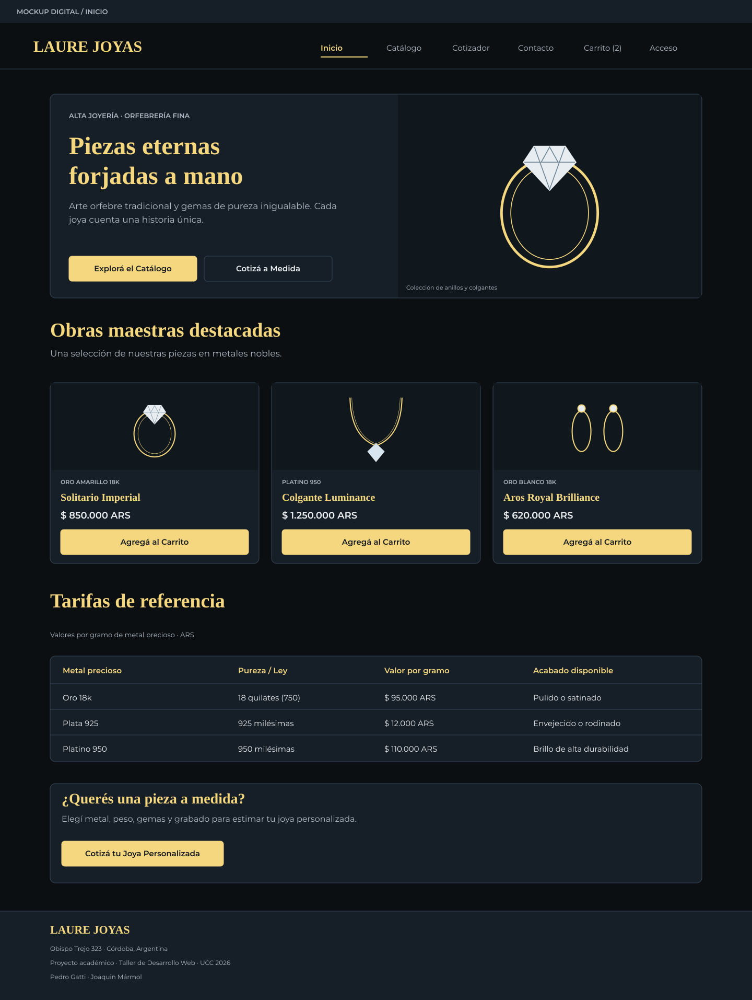

**Móvil**

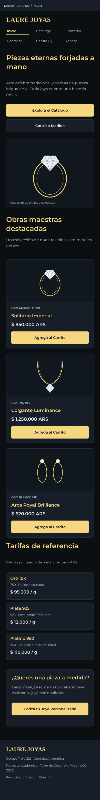

### Catálogo

**Escritorio**

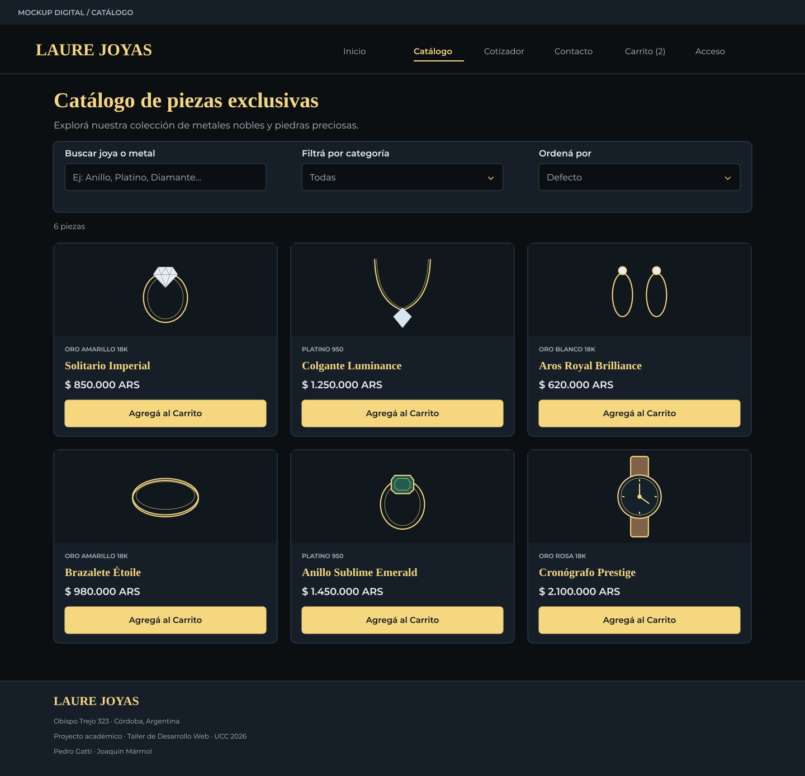

**Móvil**

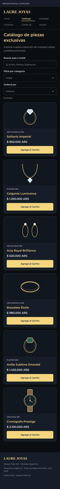

### Cotizador

**Escritorio**

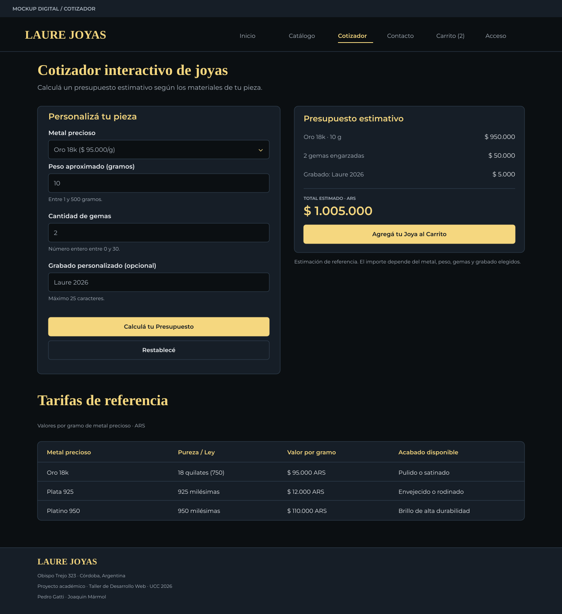

**Móvil**

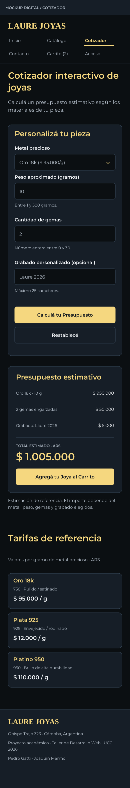

### Contacto

**Escritorio**

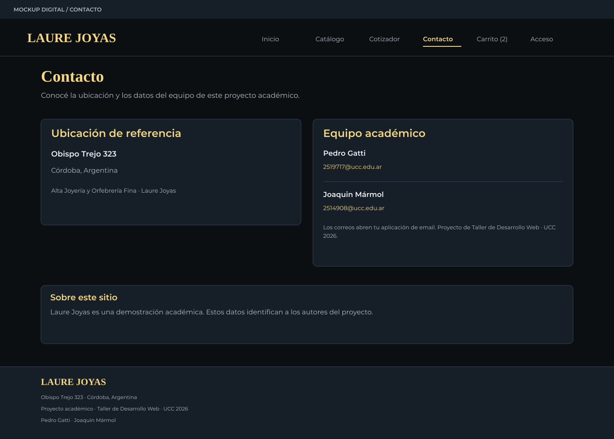

**Móvil**

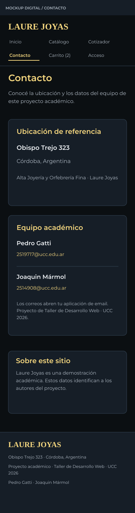

### Carrito

**Escritorio**

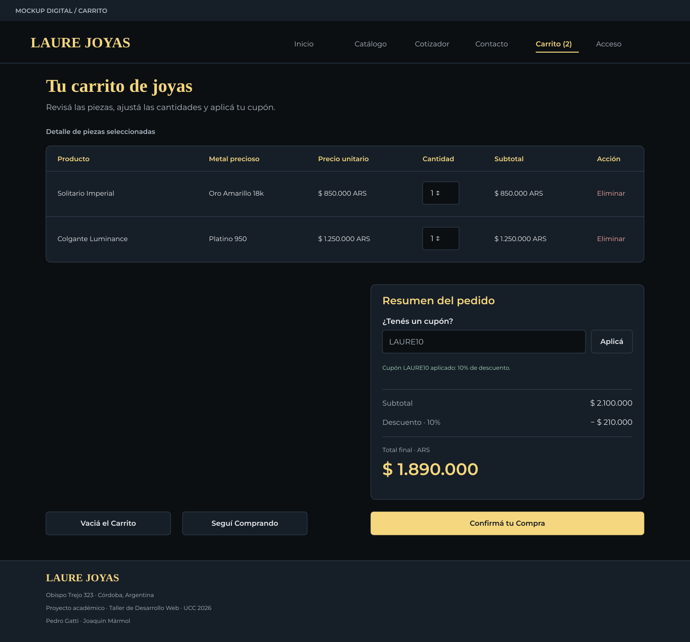

**Móvil**

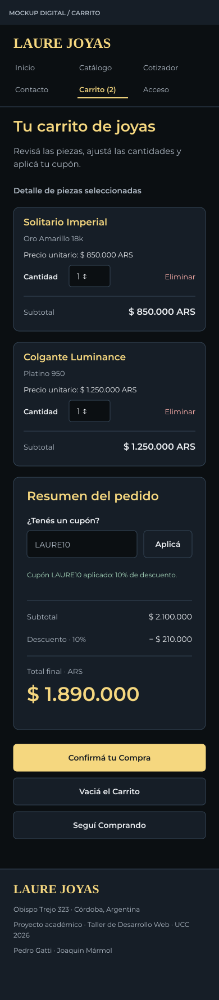

### Acceso

**Escritorio**

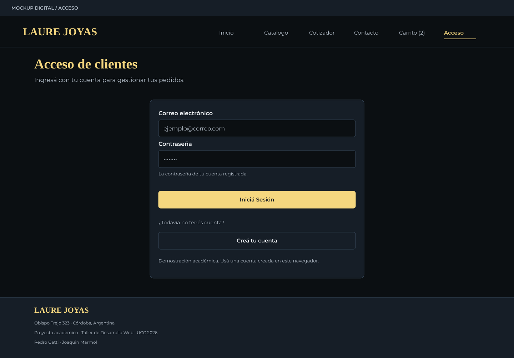

**Móvil**

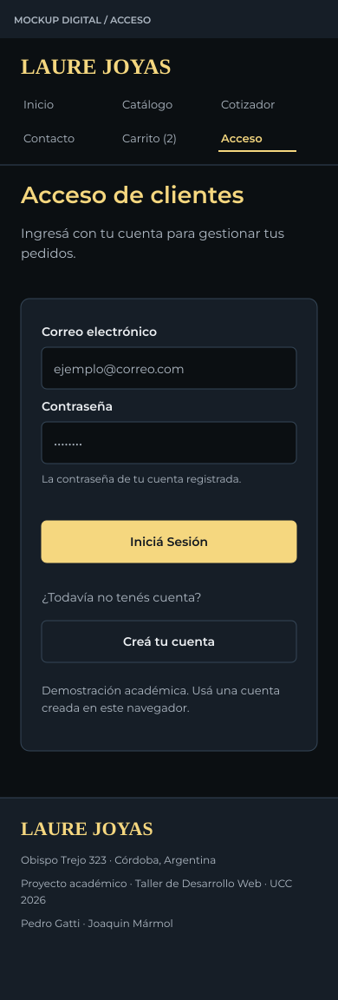

### Crear cuenta

**Escritorio**

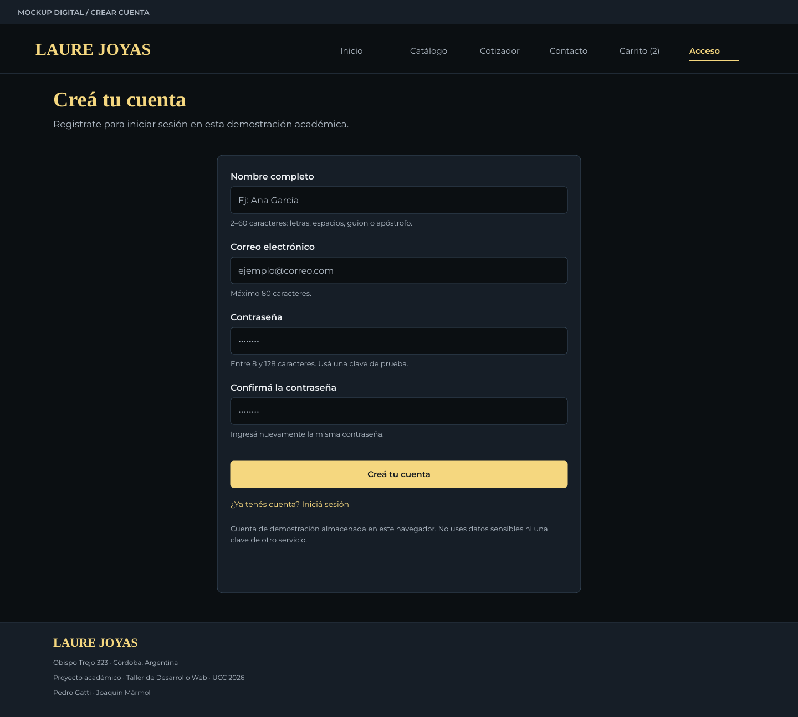

**Móvil**

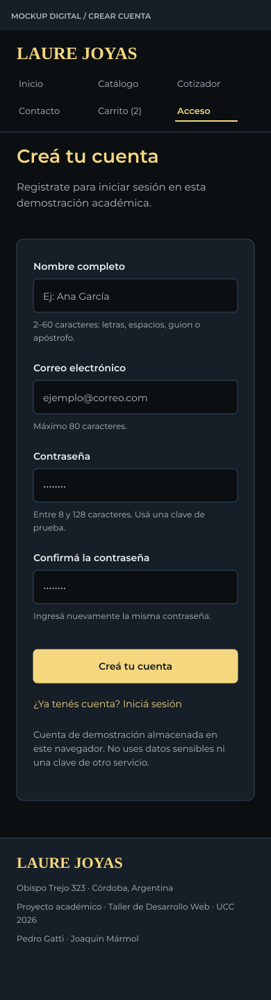

### Estados y validación

**Escritorio**

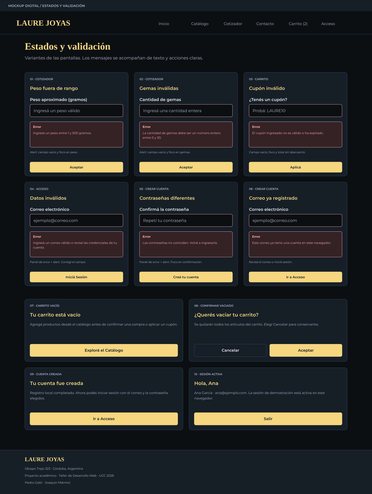

**Móvil**

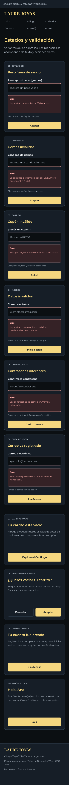

## Antecedentes conservados

El archivo [wireframes_laure_joyas.drawio](wireframes_laure_joyas.drawio) y las exportaciones originales [wireframe_desktop.png](wireframe_desktop.png), [wireframe_mobile.png](wireframe_mobile.png) y [wireframe_mensajes_error.png](wireframe_mensajes_error.png) se conservan como antecedentes. **No son las fuentes de las nuevas pantallas** de `pantallas/` ni acreditan su cobertura.

## Edición y reproducción

Los SVG usan texto y formas vectoriales editables; pueden abrirse en un editor SVG. Los PNG se exportan directamente de esos SVG. Generador compartido: [generar_prototipos.py](../Wireframe/generar_prototipos.py).

```bash
python3 primera-entrega/Wireframe/generar_prototipos.py
```

Requiere Python 3, Pillow e ImageMagick con librsvg. Las fuentes se resuelven con `fc-match` (fontconfig): preferidas Montserrat/Lato/Liberation Serif; usa las alternativas del sistema si no están disponibles. Sin fontconfig, intenta DejaVu Sans/Serif mediante Pillow. No requiere rutas de fuentes de una distribución específica. No instala dependencias ni accede a la red. Estas herramientas son requisitos de regeneración de los artefactos, no dependencias del sitio web.

El comando regenera únicamente `Sketch/pantallas/`, `Wireframe/pantallas/` y sus README. Los SVG y PNG entregados se consultan sin ejecutar el script. Para regenerar las láminas con el template oficial después de cambiar los bocetos, ejecutar también [generar_con_plantilla.py](../Sketch/generar_con_plantilla.py).
